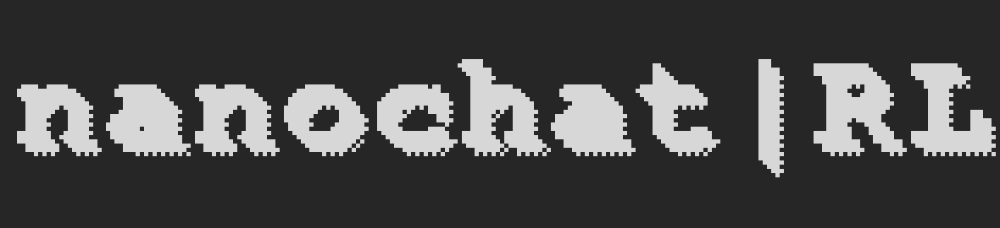

This repo hosts two distinct training frameworks that are both extremely hackable: `nanochat/` manages pretraining runs for architecture ablations, and `nanorl/` manages RL runs for objective-function ablations. Forked from [karpathy/nanochat](https://github.com/karpathy/nanochat).

# nanochat

## How to add a new architecture

Define the model and configuration in `nanochat/model/`, reusing a base class
where its behavior matches the variant. Register the config/model pair in
`nanochat/model_registry.py`; training selects it with `--model-type`, and
checkpoint metadata records that choice for evaluation. Small compatible options
can remain config flags; distinct architectures can have their own modules.

Explicitly handle initialization after meta allocation, optimizer membership,
FLOP estimates, cached inference, and checkpoint compatibility. Merely declaring
a parameter does not guarantee the correct optimizer group or initialization.
Add checks for the variant's equations and these interfaces.

## How to train and evaluate the model

For BoV comparisons, follow the [training preparation guide](runs/README.md):
select the canonical recipe, prepare a frozen run, then check/test/launch through
its generated launcher. The guide also states which functionality is on master
and which remains on `research/bank_of_values`.

Pretraining is launched from `scripts/base_train.py` via `torchrun`, which handles distributed setup, the learning-rate schedule, gradient accumulation, and periodic validation. For ablation studies, `runs/ablations.sh` wraps a batch of variants at the depth-appropriate compute budget (FLOPs defaults baked in for d12 and d24), automatically picks a sensible total batch size, and writes results into a depth-specific results folder. Variants whose checkpoint already exists in that folder are skipped, so a new variant slots in alongside the principled set without re-training the others. Validation bits-per-byte is logged throughout training and the per-variant curves get aggregated into a single CSV for direct comparison.

Evaluation runs after training via `scripts/base_eval.py`. It scores the model on the DCLM CORE suite — 21 in-context-learning tasks defined in `configs/core.yaml` using prompt fixtures from `eval_bundle/` — by either picking the highest-log-probability answer (multiple choice) or generating a short answer and matching exactly (language modeling). Output lands as one CSV per model with per-task raw accuracy and a centered score that subtracts each task's random-guessing baseline, plus a single CORE aggregate that averages the centered scores.

# nanoRL

## How to add a new objective function

Add a function to `nanorl/loss.py` and register it in the `ALGORITHMS` dictionary. The function receives the current and reference log-probabilities, rewards, and any extra kwargs, and returns a scalar loss. If the objective requires a non-standard advantage estimator (e.g. token-level instead of trajectory-level), extend `compute_advantages` with a matching branch.

## How to train the model

Training is driven by the script under `nanorl/runs/`, which launches a vLLM rollout worker for fast batched sampling and a separate `torchrun` trainer; the two stay strictly in sync so every step's rollouts come from the just-checkpointed weights. See `knowledge/rl_training.md` for the longer guide.

# Cite

```bibtex
@misc{nanochat-arch,
  author = {Muyu He, Yuchen Liu},
  title = {nanochat-arch: Architecture experiments on nanochat},
  year = {2026},
  publisher = {GitHub},
  url = {https://github.com/RiddleHe/nanochat}
}
```

This fork is based on:

```bibtex
@misc{nanochat,
  author = {Andrej Karpathy},
  title = {nanochat: The best ChatGPT that \$100 can buy},
  year = {2025},
  publisher = {GitHub},
  url = {https://github.com/karpathy/nanochat}
}
```

## License

MIT
